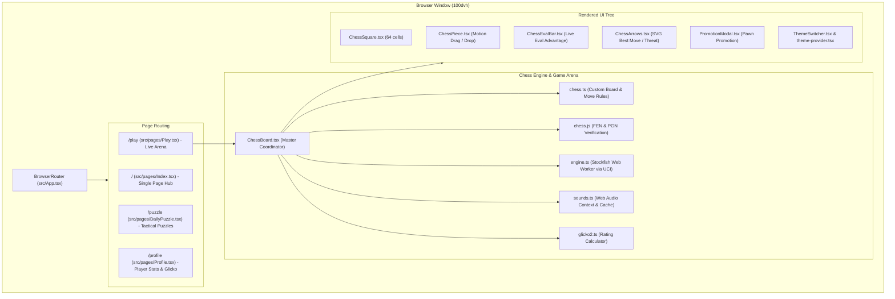

# Orange Chess — Complete Architecture & Codebase Guide

Welcome to the comprehensive technical documentation for **Orange Chess** (codenamed `lemon`). This guide covers the full architecture, technology stack, directory layout, design philosophy, and a detailed breakdown of **every single file** in the repository.

---

## Table of Contents
1. [Project Overview & Philosophy](#1-project-overview--philosophy)
2. [Complete Technology Stack](#2-complete-technology-stack)
3. [System Architecture & Data Flow](#3-system-architecture--data-flow)
4. [Design System & Styling Architecture](#4-design-system--styling-architecture)
5. [Complete Repository File Breakdown](#5-complete-repository-file-breakdown)
   - [Root & Build Configuration](#root--build-configuration)
   - [Public Assets](#public-assets)
   - [Source Entry & Application Shell (`src/`)](#source-entry--application-shell-src)
   - [Core Libraries & Engines (`src/lib/`)](#core-libraries--engines-srclib)
   - [Custom Hooks (`src/hooks/`)](#custom-hooks-srchooks)
   - [Page Views (`src/pages/`)](#page-views-srcpages)
   - [Domain Chess Components (`src/components/`)](#domain-chess-components-srccomponents)
   - [UI Primitives (`src/components/ui/`)](#ui-primitives-srccomponentsui)
   - [Test Suite (`src/test/`)](#test-suite-srctest)
6. [Deep-Dive: Core Subsystems](#6-deep-dive-core-subsystems)
   - [The Chess Coordinate System & Move Validation](#the-chess-coordinate-system--move-validation)
   - [Stockfish Web Worker & UCI Protocol Engine](#stockfish-web-worker--uci-protocol-engine)
   - [Glicko-2 Rating Engine](#glicko-2-rating-engine)
   - [Ultra-Low Latency Web Audio System](#ultra-low-latency-web-audio-system)
   - [Responsive Board Geometry & Container Queries](#responsive-board-geometry--container-queries)
7. [Study & Contribution Guide](#7-study--contribution-guide)

---

## 1. Project Overview & Philosophy

**Orange Chess** is a modern, web-native chess platform designed for competitive play, tactical training, and AI sparring. Unlike traditional chess web applications cluttered with heavy widgets and visual noise, Orange Chess adheres to three core design pillars:

1. **Distraction-Free Focus**: High-contrast, minimal UI with a signature matte orange primary palette. Specular reflections, glossy gradients, and glowing drop-shadows are deliberately excluded in favor of clean matte finishes with crisp micro-borders.
2. **Deterministic Responsiveness**: The viewport fits entirely within the screen (`100dvh`) without awkward window-level scrolling. The chessboard dynamically recalculates its dimensions using CSS Container Queries (`@container`) and inline clamp geometry.
3. **Hardware-Accurate Latency**: Custom Web Audio API pipelines ensure sub-5ms sound latency, while local Stockfish Web Workers run chess calculations off the main UI thread.

---

## 2. Complete Technology Stack

| Layer | Technology | Version | Purpose |
| :--- | :--- | :--- | :--- |
| **Runtime / Core** | [React](https://react.dev/) | `^18.3.1` | Declarative component UI and state lifecycle |
| **Language** | [TypeScript](https://www.typescriptlang.org/) | `^5.8.3` | Strict static typing across rules, engines, and state |
| **Bundler & Dev Server**| [Vite](https://vitejs.dev/) with `@vitejs/plugin-react-swc` | `^5.4.19` | Fast HMR and production bundle optimization |
| **Styling & Design** | [Tailwind CSS](https://tailwindcss.com/) | `^3.4.17` | Utility-first responsive styling and HSL token mapping |
| **Animation Engine** | [Framer Motion](https://www.framer.com/motion/) | `^12.34.5` | Move sliding, smooth drag-and-drop physics, modal transitions |
| **Headless UI** | [Radix UI](https://www.radix-ui.com/) | `^1.1.x` - `^2.1.x` | Accessible, unstyled primitives (Dialogs, Dropdowns, Tooltips) |
| **Component System** | [shadcn/ui](https://ui.shadcn.com/) | — | Reusable, composable UI component primitives |
| **Chess Rules & FEN** | Custom + [chess.js](https://github.com/jhlywa/chess.js) | `^1.4.0` | Move validation, FEN parsing, and SAN notation generation |
| **AI Chess Engine** | Stockfish 16 (UCI Web Worker) | Web Worker | Multi-threaded client-side AI analysis & opponent sparring |
| **Sound System** | Web Audio API (`AudioContext`) | Native Browser API | Zero-lag synchronized sound buffers with volume control |
| **Data Visualization** | [Recharts](https://recharts.org/) | `^2.15.4` | Rating history curves and profile win/loss graphs |
| **Icons** | [Lucide React](https://lucide.dev/) | `^0.462.0` | Crisp vector icons matching stroke weights |
| **Test Runner** | [Vitest](https://vitest.dev/) + [Testing Library](https://testing-library.com/) | `^3.2.4` | Fast unit testing with JSDOM environment |

---

## 3. System Architecture & Data Flow



### Data Flow Lifecycle:
1. **Move Initiation**: The user clicks or drags a piece in `ChessSquare.tsx` / `ChessPiece.tsx`.
2. **Validation**: `ChessBoard.tsx` queries `getLegalMoves()` from `src/lib/chess.ts`. If invalid, `playErrorSound()` is triggered via `sounds.ts`.
3. **Execution**: The board state is immutably updated. Castling rights, en passant, halfmove clock, and promotion triggers are computed.
4. **Audio Feedback**: `playMoveSound()` or `playCaptureSound()` executes synchronously through the native `AudioContext` buffer cache.
5. **Stockfish Evaluation & Bot Response**:
   - `boardToFen()` transforms the 8x8 matrix into a FEN string.
   - The FEN is dispatched via `postMessage` to the Stockfish Web Worker.
   - Stockfish calculates candidate moves and returns `bestmove` and evaluation centipawns (`evalcp`).
   - `ChessEvalBar.tsx` animates the advantage bar, and `ChessArrows.tsx` projects tactical arrows onto the board.
6. **Game Conclusion & Rating Update**: Checkmate or resignation triggers `calculateGlickoUpdate()` in `src/lib/glicko2.ts`, saving new ratings to `localStorage`.

---

## 4. Design System & Styling Architecture

The application uses Tailwind CSS combined with CSS Custom Properties (`src/index.css`) for seamless theming:

### Themes Available:
1. **Standard Dark (`:root`)**: Deep navy-slate base (`hsl(220 20% 7%)`) with vibrant matte orange accent (`hsl(25 90% 55%)`).
2. **Charcoal (`.theme-charcoal`)**: Neutral dark graphite (`hsl(210 5% 12%)`) with crisp contrast squares.
3. **Batman (`.theme-batman`)**: Ultra-deep pitch black (`hsl(220 10% 2%)`) with high-contrast piece markers.

### Key CSS Utility Classes (`src/index.css`):
- `.skeuo-btn`: Matte card button with subtle border and 2px neutral drop-shadow. No glossy sheen.
- `.skeuo-btn-primary`: Vibrant solid matte orange button (`hsl(25 90% 50%)`) with clean hover lift.
- `.skeuo-panel`: Dark container panel with 1px neutral border (`rgba(255,255,255,0.08)`) and soft depth shadow.
- `.skeuo-inner`: Inset recessed container for timers, clocks, and scoreboards.
- `.chess-square`: Declares `container-type: inline-size` for container query scaling of piece glyphs.

---

## 5. Complete Repository File Breakdown

### Root & Build Configuration

| File | Purpose | Key Details |
| :--- | :--- | :--- |
| [`package.json`](file:///c:/Users/AARYAN/OneDrive/New%20folder/OneDrive/Apps/lemon/package.json) | Project manifest | Defines dependencies, test harness, build scripts (`vite build`), and dev script (`vite --host`). |
| [`bun.lock`](file:///c:/Users/AARYAN/OneDrive/New%20folder/OneDrive/Apps/lemon/bun.lock) | Package lockfile | Deterministic dependency tree lock for Bun / npm package installations. |
| [`package-lock.json`](file:///c:/Users/AARYAN/OneDrive/New%20folder/OneDrive/Apps/lemon/package-lock.json) | npm lockfile | Lockfile for npm package management. |
| [`vite.config.ts`](file:///c:/Users/AARYAN/OneDrive/New%20folder/OneDrive/Apps/lemon/vite.config.ts) | Vite build config | Configures the `@vitejs/plugin-react-swc` fast compiler, path alias `@ -> /src`, and dev server port 8080. |
| [`tsconfig.json`](file:///c:/Users/AARYAN/OneDrive/New%20folder/OneDrive/Apps/lemon/tsconfig.json) | Root TypeScript config | References `tsconfig.app.json` (application source) and `tsconfig.node.json` (build scripts). |
| [`tsconfig.app.json`](file:///c:/Users/AARYAN/OneDrive/New%20folder/OneDrive/Apps/lemon/tsconfig.app.json) | Client TypeScript config | Enables strict typing, JSX preservation, ES2020 target, and path alias mapping. |
| [`tsconfig.node.json`](file:///c:/Users/AARYAN/OneDrive/New%20folder/OneDrive/Apps/lemon/tsconfig.node.json) | Node TypeScript config | Type-checks Vite and PostCSS configuration scripts. |
| [`tailwind.config.ts`](file:///c:/Users/AARYAN/OneDrive/New%20folder/OneDrive/Apps/lemon/tailwind.config.ts) | Tailwind configuration | Maps HSL CSS variables to theme colors (`primary`, `card`, `background`, `chess-light`, `chess-dark`), declares custom font families (`Space Grotesk`, `Inter`, `JetBrains Mono`), and configures animations. |
| [`postcss.config.js`](file:///c:/Users/AARYAN/OneDrive/New%20folder/OneDrive/Apps/lemon/postcss.config.js) | PostCSS config | Registers `tailwindcss` and `autoprefixer` plugins for processing CSS. |
| [`eslint.config.js`](file:///c:/Users/AARYAN/OneDrive/New%20folder/OneDrive/Apps/lemon/eslint.config.js) | Linter configuration | ESLint 9 flat configuration with React Hooks and TypeScript rules. |
| [`components.json`](file:///c:/Users/AARYAN/OneDrive/New%20folder/OneDrive/Apps/lemon/components.json) | shadcn/ui config | Defines aliases (`@/components`, `@/lib/utils`) and styling preset for shadcn CLI component additions. |
| [`vitest.config.ts`](file:///c:/Users/AARYAN/OneDrive/New%20folder/OneDrive/Apps/lemon/vitest.config.ts) | Test runner config | Integrates Vitest with Vite plugins and configures JSDOM as the test environment. |
| [`index.html`](file:///c:/Users/AARYAN/OneDrive/New%20folder/OneDrive/Apps/lemon/index.html) | HTML document entry | Sets viewport scaling, preloads Google Fonts (`Space Grotesk`, `Inter`, `JetBrains Mono`), and mounts `<div id="root"></div>`. |
| [`README.md`](file:///c:/Users/AARYAN/OneDrive/New%20folder/OneDrive/Apps/lemon/README.md) | Project overview | Getting-started instructions and run commands. |

---

### Public Assets (`public/`)

| File | Purpose |
| :--- | :--- |
| `public/favicon.ico` | Web browser tab icon. |
| `public/placeholder.svg` | Placeholder vector graphic. |
| `public/robots.txt` | Directs search engine web crawlers. |
| `public/sounds/move.mp3` | Audio recording for normal piece moves. |
| `public/sounds/capture.wav` | Crisp tactile sound played when a piece is captured. |
| `public/sounds/capture.mp3` | Fallback compressed audio for captures. |
| `public/sounds/castle.mp3` | Distinctive sound played during king-side or queen-side castling. |
| `public/sounds/checkmate.mp3`| Triumphant/decisive chord triggered on game-ending checkmate. |
| `public/sounds/error.mp3` | Subtle haptic sound triggered when an illegal move is attempted. |

---

### Source Entry & Application Shell (`src/`)

| File | Purpose | Key Details |
| :--- | :--- | :--- |
| [`src/main.tsx`](file:///c:/Users/AARYAN/OneDrive/New%20folder/OneDrive/Apps/lemon/src/main.tsx) | Application bootstrap | Renders the `<App />` root into `#root` using React 18 `createRoot`. |
| [`src/App.tsx`](file:///c:/Users/AARYAN/OneDrive/New%20folder/OneDrive/Apps/lemon/src/App.tsx) | Root application component | Sets up `ThemeProvider`, `TooltipProvider`, `Toaster`, and the `react-router-dom` routing tree. |
| [`src/index.css`](file:///c:/Users/AARYAN/OneDrive/New%20folder/OneDrive/Apps/lemon/src/index.css) | Global stylesheet | Declares typography tokens, theme CSS variables (`:root`, `.theme-charcoal`, `.theme-batman`), matte panel & button utility classes, and custom scrollbars. |
| [`src/App.css`](file:///c:/Users/AARYAN/OneDrive/New%20folder/OneDrive/Apps/lemon/src/App.css) | Auxiliary stylesheet | Cleaned utility stylesheet reserved for application-wide overrides. |
| [`src/vite-env.d.ts`](file:///c:/Users/AARYAN/OneDrive/New%20folder/OneDrive/Apps/lemon/src/vite-env.d.ts) | Ambient type declarations | Provides TypeScript definitions for Vite client features (importing SVG, assets, env vars). |

---

### Core Libraries & Engines (`src/lib/`)

| File | Purpose | Key Details |
| :--- | :--- | :--- |
| [`src/lib/chess.ts`](file:///c:/Users/AARYAN/OneDrive/New%20folder/OneDrive/Apps/lemon/src/lib/chess.ts) | **Chess Rules Engine** | Implements the pure domain chess logic: board creation (`createInitialBoard`), legal move generation (`getLegalMoves`), check/checkmate/stalemate detection (`isCheckmate`, `isStalemate`), castling path verification (`isSquareAttackedBy`), en passant, and algebraic notation (`formatMoveToSan`). |
| [`src/lib/engine.ts`](file:///c:/Users/AARYAN/OneDrive/New%20folder/OneDrive/Apps/lemon/src/lib/engine.ts) | **Stockfish & FEN Bridge** | Converts between 2D board arrays and FEN strings (`boardToFen`, `fenToBoard`). Manages the Stockfish 16 UCI Web Worker lifecycle, command queues, skill levels (1–10), and evaluation parsing. Includes a fallback heuristic evaluator when offline. |
| [`src/lib/glicko2.ts`](file:///c:/Users/AARYAN/OneDrive/New%20folder/OneDrive/Apps/lemon/src/lib/glicko2.ts) | **Glicko-2 Rating Engine** | Full mathematical implementation of Mark Glickman's Glicko-2 rating system. Calculates updated rating ($\mu$), rating deviation ($\phi / \text{RD}$), and volatility ($\sigma$) based on match results against opponents or computer levels. |
| [`src/lib/sounds.ts`](file:///c:/Users/AARYAN/OneDrive/New%20folder/OneDrive/Apps/lemon/src/lib/sounds.ts) | **Low-Latency Audio Engine** | Uses a singleton `AudioContext` with `latencyHint: 'interactive'` and an in-memory `AudioBuffer` cache. Bypasses the HTML5 `<audio>` element to deliver instant (<5ms) move, capture, castle, and checkmate sounds. Includes mute state persistence. |
| [`src/lib/utils.ts`](file:///c:/Users/AARYAN/OneDrive/New%20folder/OneDrive/Apps/lemon/src/lib/utils.ts) | **Tailwind Class Utility** | Exports the `cn()` helper, combining `clsx` for conditional classes and `tailwind-merge` to resolve conflicting Tailwind utility classes cleanly. |

---

### Custom Hooks (`src/hooks/`)

| File | Purpose | Key Details |
| :--- | :--- | :--- |
| [`src/hooks/use-mobile.tsx`](file:///c:/Users/AARYAN/OneDrive/New%20folder/OneDrive/Apps/lemon/src/hooks/use-mobile.tsx) | Responsive detection hook | Subscribes to `window.matchMedia('(max-width: 768px)')` to trigger responsive layout switches between mobile and desktop views. |
| [`src/hooks/use-toast.ts`](file:///c:/Users/AARYAN/OneDrive/New%20folder/OneDrive/Apps/lemon/src/hooks/use-toast.ts) | Toast notification manager | Redux/reducer-like hook providing `toast()`, `dismiss()`, and auto-expiring alert state for the `Toaster` component. |

---

### Page Views (`src/pages/`)

| File | Purpose | Key Details |
| :--- | :--- | :--- |
| [`src/pages/Index.tsx`](file:///c:/Users/AARYAN/OneDrive/New%20folder/OneDrive/Apps/lemon/src/pages/Index.tsx) | **Home Page (Single Viewport)** | Distraction-free, unscrollable home dashboard (`100dvh`). Features the hero title ("Play beautiful chess."), active player statistics, Play Online configuration dialog (Bullet, Blitz, Rapid), Computer Sparring configuration dialog (Squire to Grandmaster), Daily Puzzle entry, and Live Events feed. |
| [`src/pages/Play.tsx`](file:///c:/Users/AARYAN/OneDrive/New%20folder/OneDrive/Apps/lemon/src/pages/Play.tsx) | **Game Arena Page** | Reads URL query params (`?mode=computer&level=4&time=0&inc=0`), mounts the primary `ChessBoard` component with a unique key to ensure fresh game state, and provides a quick Return to Home link. |
| [`src/pages/DailyPuzzle.tsx`](file:///c:/Users/AARYAN/OneDrive/New%20folder/OneDrive/Apps/lemon/src/pages/DailyPuzzle.tsx) | **Tactical Puzzle Trainer** | Loads curated tactical puzzles, presents the player with specific board positions, verifies tactical move solutions, provides progressive hints, tracks daily streaks, and presents an interactive solution board. |
| [`src/pages/Profile.tsx`](file:///c:/Users/AARYAN/OneDrive/New%20folder/OneDrive/Apps/lemon/src/pages/Profile.tsx) | **Player Profile & Analytics** | Visualizes player performance: Knight profile badge, Glicko-2 ratings by time control (Bullet, Blitz, Rapid), Recharts rating progression curves, win/draw/loss donut charts, recent match history, achievements, and active friends list. |
| [`src/pages/NotFound.tsx`](file:///c:/Users/AARYAN/OneDrive/New%20folder/OneDrive/Apps/lemon/src/pages/NotFound.tsx) | **404 Fallback Page** | Graceful error screen for undefined routes with a one-click return to home button. |

---

### Domain Chess Components (`src/components/`)

| File | Purpose | Key Details |
| :--- | :--- | :--- |
| [`src/components/ChessBoard.tsx`](file:///c:/Users/AARYAN/OneDrive/New%20folder/OneDrive/Apps/lemon/src/components/ChessBoard.tsx) | **Master Game Coordinator** | The central component of the application (~1700 lines). Controls game clocks, turn management, drag/drop coordination, board flipping, Stockfish bot triggers, move history logs, material differential calculation, advantage indicators, auto-queen toggles, resign/draw dialogs, and game over match reports. |
| [`src/components/ChessSquare.tsx`](file:///c:/Users/AARYAN/OneDrive/New%20folder/OneDrive/Apps/lemon/src/components/ChessSquare.tsx) | **Individual Chess Square** | Renders each of the 64 squares. Uses container queries (`@container`) for piece sizing, manages click/drop events, and renders flat matte highlight overlays for last move, piece selection, valid move targets (dots/rings), and king in check. |
| [`src/components/ChessPiece.tsx`](file:///c:/Users/AARYAN/OneDrive/New%20folder/OneDrive/Apps/lemon/src/components/ChessPiece.tsx) | **Interactive Chess Piece** | Renders piece glyphs with Framer Motion drag physics. Handles drag constraints, drop target detection, selection states, and smooth translate transitions during moves. |
| [`src/components/ChessEvalBar.tsx`](file:///c:/Users/AARYAN/OneDrive/New%20folder/OneDrive/Apps/lemon/src/components/ChessEvalBar.tsx) | **Live Stockfish Eval Bar** | Vertical advantage bar showing White vs. Black evaluation from -10 to +10 centipawns or mate counts. Uses a clean matte divider and updates in real-time as Stockfish analyzes positions. |
| [`src/components/ChessArrows.tsx`](file:///c:/Users/AARYAN/OneDrive/New%20folder/OneDrive/Apps/lemon/src/components/ChessArrows.tsx) | **Tactical Arrows Overlay** | SVG layer rendered directly over the board. Projects arrows for coach suggestions, best moves, and threat warnings using SVG coordinate projections and custom marker heads. |
| [`src/components/PromotionModal.tsx`](file:///c:/Users/AARYAN/OneDrive/New%20folder/OneDrive/Apps/lemon/src/components/PromotionModal.tsx) | **Pawn Promotion Dialog** | Modal that appears when a pawn reaches the 8th rank (or 1st rank for Black), allowing the player to promote to a Queen, Rook, Bishop, or Knight. Can be bypassed if "Auto-Queen" is enabled. |
| [`src/components/ThemeSwitcher.tsx`](file:///c:/Users/AARYAN/OneDrive/New%20folder/OneDrive/Apps/lemon/src/components/ThemeSwitcher.tsx) | **Theme Selector** | Dropdown button allowing instantaneous switching between Standard Dark, Charcoal, and Batman themes. |
| [`src/components/theme-provider.tsx`](file:///c:/Users/AARYAN/OneDrive/New%20folder/OneDrive/Apps/lemon/src/components/theme-provider.tsx) | **Theme Context Provider** | React Context that reads from `localStorage`, manages the active theme class on `document.documentElement`, and exposes `useTheme()`. |
| [`src/components/NavLink.tsx`](file:///c:/Users/AARYAN/OneDrive/New%20folder/OneDrive/Apps/lemon/src/components/NavLink.tsx) | **Navigation Link** | Accessible link wrapper for header and sidebar navigation elements. |

---

### UI Primitives (`src/components/ui/`)

These components are built on top of [Radix UI](https://www.radix-ui.com/) and styled with Tailwind CSS via [shadcn/ui]:

| Component | File | Underlying Radix Primitive | Purpose |
| :--- | :--- | :--- | :--- |
| **Button** | [`button.tsx`](file:///c:/Users/AARYAN/OneDrive/New%20folder/OneDrive/Apps/lemon/src/components/ui/button.tsx) | `Slot` | Reusable button with variants (`default`, `destructive`, `outline`, `secondary`, `ghost`, `link`). |
| **Card** | [`card.tsx`](file:///c:/Users/AARYAN/OneDrive/New%20folder/OneDrive/Apps/lemon/src/components/ui/card.tsx) | — | Standard card layout container (`CardHeader`, `CardTitle`, `CardContent`, `CardFooter`). |
| **Dialog** | [`dialog.tsx`](file:///c:/Users/AARYAN/OneDrive/New%20folder/OneDrive/Apps/lemon/src/components/ui/dialog.tsx) | `@radix-ui/react-dialog` | Accessible modal dialog for match config, promotion, and resign confirmations. |
| **DropdownMenu**| [`dropdown-menu.tsx`](file:///c:/Users/AARYAN/OneDrive/New%20folder/OneDrive/Apps/lemon/src/components/ui/dropdown-menu.tsx) | `@radix-ui/react-dropdown-menu` | Floating contextual menu for theme switching and options. |
| **Input** | [`input.tsx`](file:///c:/Users/AARYAN/OneDrive/New%20folder/OneDrive/Apps/lemon/src/components/ui/input.tsx) | — | Styled text input for player names, search, or settings. |
| **Label** | [`label.tsx`](file:///c:/Users/AARYAN/OneDrive/New%20folder/OneDrive/Apps/lemon/src/components/ui/label.tsx) | `@radix-ui/react-label` | Accessible form label with font-medium styling. |
| **Separator** | [`separator.tsx`](file:///c:/Users/AARYAN/OneDrive/New%20folder/OneDrive/Apps/lemon/src/components/ui/separator.tsx) | `@radix-ui/react-separator` | Horizontal or vertical divider lines. |
| **Skeleton** | [`skeleton.tsx`](file:///c:/Users/AARYAN/OneDrive/New%20folder/OneDrive/Apps/lemon/src/components/ui/skeleton.tsx) | — | Pulsing placeholder block during async data loading. |
| **Toast** | [`toast.tsx`](file:///c:/Users/AARYAN/OneDrive/New%20folder/OneDrive/Apps/lemon/src/components/ui/toast.tsx) | `@radix-ui/react-toast` | Animated toast alert item with title, description, and close action. |
| **Toaster** | [`toaster.tsx`](file:///c:/Users/AARYAN/OneDrive/New%20folder/OneDrive/Apps/lemon/src/components/ui/toaster.tsx) | `@radix-ui/react-toast` | Toast viewport container mounted globally in `src/App.tsx`. |
| **Toggle** | [`toggle.tsx`](file:///c:/Users/AARYAN/OneDrive/New%20folder/OneDrive/Apps/lemon/src/components/ui/toggle.tsx) | `@radix-ui/react-toggle` | Two-state toggle button used in toolbar controls. |
| **Tooltip** | [`tooltip.tsx`](file:///c:/Users/AARYAN/OneDrive/New%20folder/OneDrive/Apps/lemon/src/components/ui/tooltip.tsx) | `@radix-ui/react-tooltip` | Hover tooltip providing microcopy descriptions for icons and buttons. |

---

### Test Suite (`src/test/`)

| File | Purpose |
| :--- | :--- |
| [`src/test/setup.ts`](file:///c:/Users/AARYAN/OneDrive/New%20folder/OneDrive/Apps/lemon/src/test/setup.ts) | Imports `@testing-library/jest-dom` matchers to extend Vitest's `expect` assertions. |
| [`src/test/example.test.ts`](file:///c:/Users/AARYAN/OneDrive/New%20folder/OneDrive/Apps/lemon/src/test/example.test.ts) | Unit test template demonstrating Vitest assertions (`describe`, `it`, `expect`). |

---

## 6. Deep-Dive: Core Subsystems

### The Chess Coordinate System & Move Validation
The board is represented internally as an 8x8 matrix `(Piece | null)[][]`:
- **Row 0** represents Rank 8 (Black's back rank: a8 to h8).
- **Row 7** represents Rank 1 (White's back rank: a1 to h1).
- **Col 0 to 7** represent Files `a` through `h`.

`src/lib/chess.ts` calculates moves in two phases:
1. **Pseudo-legal Generation**: Generates moves following movement rules (pawns 1 or 2 squares forward, diagonal captures, knight L-shapes, rays for bishops, rooks, queens, and 1-square steps for kings).
2. **King Safety Verification**: For every candidate move, a temporary board copy is simulated. If the moving player's king is under attack (`isSquareAttackedBy`), the move is filtered out. Only moves leaving the king safe are considered strictly legal.

---

### Stockfish Web Worker & UCI Protocol Engine
Rather than blocking the main JavaScript thread, Stockfish executes inside a Web Worker (`src/lib/engine.ts`).

#### Communication Flow:
1. **Init**: The worker is sent `uci` $\rightarrow$ responds with `uciok`.
2. **Configuration**: Sent `setoption name Skill Level value <level>`, mapping difficulty 1–10 to Stockfish rating caps (~800 to 2800 ELO).
3. **Position Load**: `position fen <fen_string>` loads the current board state.
4. **Analysis Dispatch**: `go depth <depth> movetime <ms>` triggers calculation.
5. **Output Parsing**: Stockfish streams `info depth ... score cp <centipawns> pv ...` back to the main thread:
   - Centipawns are converted to winning probability percentages for `ChessEvalBar.tsx`.
   - The final `bestmove <from><to>` is executed as the bot's turn.

---

### Glicko-2 Rating Engine
Implemented in `src/lib/glicko2.ts`, Glicko-2 improves on standard Elo by tracking three parameters for each player:
- **Rating ($\mu$)**: The player's estimated skill (default 1500).
- **Rating Deviation ($\phi$ / $\text{RD}$)**: Uncertainty in the rating (default 350). RD decreases after games and increases over periods of inactivity.
- **Rating Volatility ($\sigma$)**: Measures the consistency of the player's performance.

When a game ends, `calculateGlickoUpdate()` calculates expected outcome $E(s)$, updates the rating deviation, adjusts for volatility, and outputs the new numerical rating shown on the player's profile and match reports.

---

### Ultra-Low Latency Web Audio System
Standard browser audio elements (`new Audio('...')`) suffer from 50ms–150ms latency due to file decoding on demand. `src/lib/sounds.ts` solves this:
1. **Global `AudioContext`**: Initialized with `latencyHint: 'interactive'`.
2. **In-Memory Buffering**: Audio buffers (`capture.wav`, `move.mp3`, `castle.mp3`, `checkmate.mp3`) are fetched and pre-decoded once into `AudioBuffer` objects in memory.
3. **Synchronous Hardware Playback**: When a piece drops, `playBufferImmediate()` attaches an `AudioBufferSourceNode` to a `GainNode` and starts playback at offset `0` synchronously, yielding instantaneous (<5ms) acoustic feedback.

---

### Responsive Board Geometry & Container Queries
To maintain an unscrollable 1-page layout across any laptop, tablet, or monitor:
1. The board container scales according to:
   $$\text{boardSize} = \min(100\text{cqw} - 48\text{px},\ 100\text{dvh} - 150\text{px},\ 760\text{px})$$
2. Ranks `1–8` and Files `a–h` are bound to exact CSS `grid-rows-8` and `grid-cols-8` containers matching the board's pixel height and width.
3. Individual squares use `@container (inline-size)` so piece typography and glyphs scale proportionally without pixel distortion.

---

## 7. Study & Contribution Guide

### Running Locally
```bash
# Install dependencies
npm install

# Start the development server (runs on port 8080)
npm run dev

# Run unit tests
npm run test

# Build for production
npm run build
```

### Key Files to Study by Topic:
- **To learn Chess Move Rules & Board State**: Start at [`src/lib/chess.ts`](file:///c:/Users/AARYAN/OneDrive/New%20folder/OneDrive/Apps/lemon/src/lib/chess.ts).
- **To learn Game Flow & State Orchestration**: Read [`src/components/ChessBoard.tsx`](file:///c:/Users/AARYAN/OneDrive/New%20folder/OneDrive/Apps/lemon/src/components/ChessBoard.tsx).
- **To learn Stockfish Web Worker Integration**: Inspect [`src/lib/engine.ts`](file:///c:/Users/AARYAN/OneDrive/New%20folder/OneDrive/Apps/lemon/src/lib/engine.ts).
- **To learn Rating Math (Glicko-2)**: Study [`src/lib/glicko2.ts`](file:///c:/Users/AARYAN/OneDrive/New%20folder/OneDrive/Apps/lemon/src/lib/glicko2.ts).
- **To learn Zero-Lag Browser Audio**: Check [`src/lib/sounds.ts`](file:///c:/Users/AARYAN/OneDrive/New%20folder/OneDrive/Apps/lemon/src/lib/sounds.ts).
- **To learn Matte Theming & Design Tokens**: Review [`src/index.css`](file:///c:/Users/AARYAN/OneDrive/New%20folder/OneDrive/Apps/lemon/src/index.css) and [`tailwind.config.ts`](file:///c:/Users/AARYAN/OneDrive/New%20folder/OneDrive/Apps/lemon/tailwind.config.ts).
